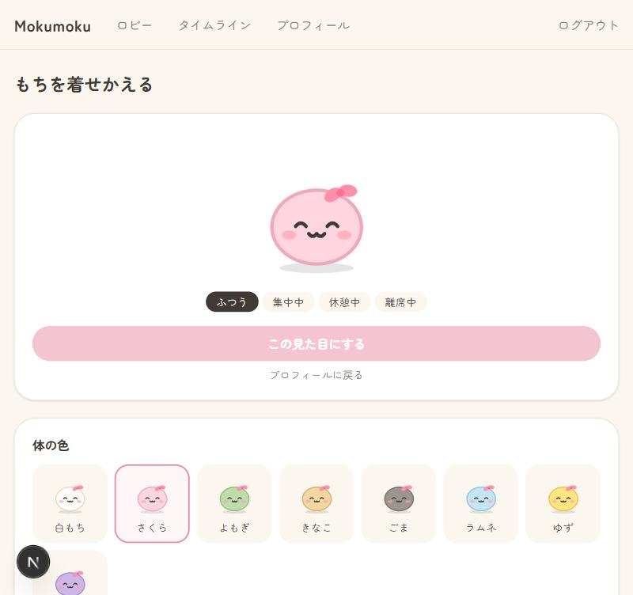
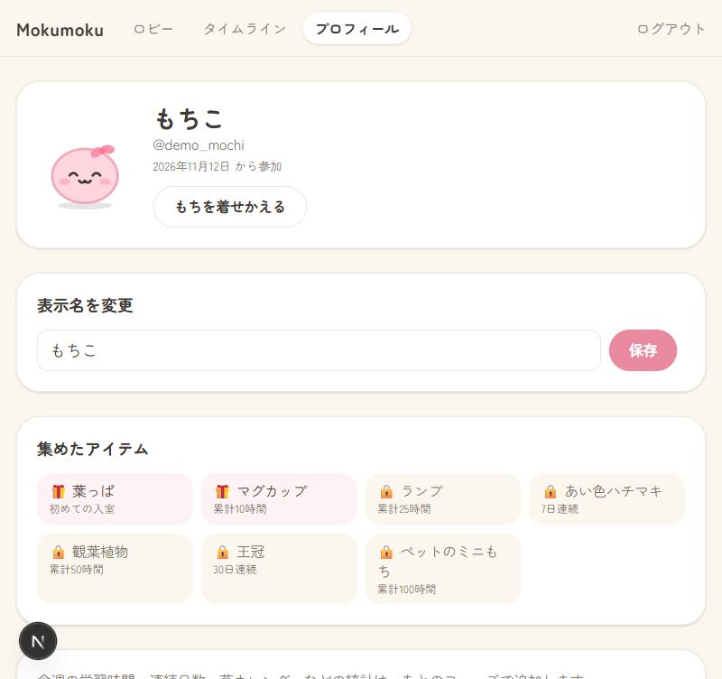
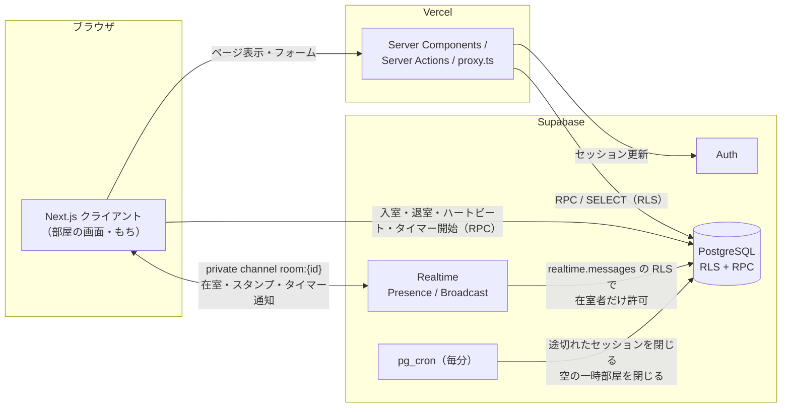
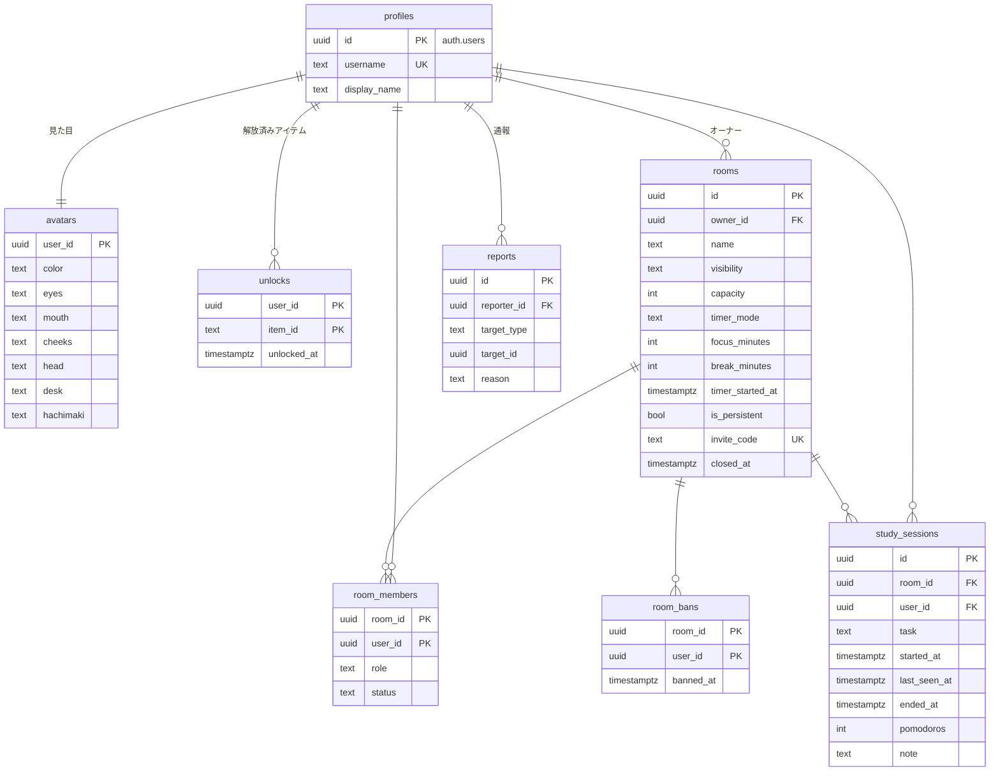

# Mokumoku（仮）

おしゃべりなしの、オンライン「もくもく自習室」。

自分で自習部屋を作ったり、ほかの人の部屋に入ったりできます。部屋の中で会話はできず、交流はスタンプ（👏🔥☕💪）だけ。
同じ部屋にいる人のアバター「もち」と「今やっていること」がリアルタイムに並び、退室すると、自分だけに見える学習の記録に自動で残ります。

<p align="center">
  
  
</p>

- **デモURL**：（デプロイ後に記載。手順は [docs/deploy.md](docs/deploy.md)）
- もちが動く GIF：（デプロイ後に追加予定）

## 作った理由

ひとりで勉強していると、つい集中が切れてしまいます。かといって通話つきの勉強会は気をつかう。
「だれかが同じ時間にがんばっている」ことだけが静かに伝わる場所があれば、続けやすいのでは、と考えて作りました。
アバターを丸いおもち型の生き物にしたのは、かわいさと愛着で「また来よう」と思えるようにするためです。

## 主な機能

| 機能 | 内容 |
|---|---|
| 自習部屋 | 公開／限定（招待URLのみ）／承認制、定員2〜20人、ポモドーロ同期 or 自由、常設 or 一時 |
| 在室表示 | もちが机に並び、今やること・状態（集中中／休憩中）がリアルタイムに変わる |
| ポモドーロ同期 | オーナーが開始すると、途中から入った人も含めて全員のタイマーがそろう |
| スタンプ | 相手のもちを選んで送ると、絵文字が放物線を描いて飛び、受け取ったもちが跳ねる（2秒に1回まで・ポモドーロ中は休憩中のみ） |
| 学習の記録 | 退室すると学習時間・ポモドーロ回数・やったことが自動で記録に残る（1分以上）。任意でメモを付けられる。記録は自分にしか見えない |
| エモート | よろしく・ありがとう・ひらめいた など9種類。自分のもちが動いて部屋のみんなに見える（いつでも使える・3秒に1回まで） |
| もち | 体の色8種・目5種・口4種・ほっぺ3種・頭と机の小物。呼吸・まばたき・状態ごとの動き・ポモドーロ完了のジャンプ |
| 招待・承認 | 招待URL `/r/{code}` から入室前画面へ直接移動。承認制の部屋はオーナーが申請を承認 |
| 自動退室 | ブラウザを閉じても、ハートビートが途切れて3分後に自動で退室扱い |
| ストップウォッチ | 自由モードの部屋では自分用のストップウォッチを開始・停止でき、時間はほかの人にも見える |
| モデレーション | オーナー・モデレーターはキック・BAN。オーナーはモデレーターを任命。部屋名・説明文にNGワードフィルタ。部屋・ユーザーを通報できる |
| 統計と成長 | 今週の合計・連続日数・週グラフ・草カレンダー・タグ別の割合。累計時間や連続日数でもちの小物が解放される（退室時にサーバーで判定） |
| 部屋の背景 | 図書館・カフェ・和室・宇宙のテーマ。窓の外が時間帯（朝・昼・夕方・夜）で変わり、休憩中は部屋が少し明るくなる |

## 技術スタック

- **フロントエンド**：Next.js 16（App Router / Server Actions）、TypeScript、Tailwind CSS v4
- **バックエンド**：Supabase（Auth、PostgreSQL + RLS、Realtime の Presence / Broadcast、pg_cron）
- **テスト**：Vitest（ロジック）、pgTAP（RLS・RPC）、Playwright（E2E）
- **CI**：GitHub Actions（lint、型チェック、Vitest、DB lint + pgTAP、E2E）
- **デプロイ**：Vercel

## アーキテクチャ



**DB に書くのは「入室・退室・ハートビート」だけ**です。だれが今いるか・今やっていること・状態は Realtime Presence で共有し、DB には書きません。

## ER 図



## 技術的に工夫した点

### Presence の活用（在室状態を DB に書かない）
在室者・今やること・状態（集中中／休憩中）・アバターのパーツIDは、private channel `room:{id}` の Presence で共有しています。
タイマーのフェーズから状態を決め、変わったときだけ `track` し直します（タブを離れても離席中にはしません）。
同じ人が複数タブで開いた場合は、更新時刻が一番新しいものを採用します（[src/lib/presence.ts](src/lib/presence.ts)）。

### 行ロックによる定員制御
入室は `enter_room` RPC で行い、**部屋の行を `select ... for update` でロックしてから** BAN・招待コード・承認・定員を確認します。同時に何人が押しても、定員チェックは1人ずつ順番に行われます。
同じユーザーの操作は advisory lock で直列化し、ロックの順番を「ユーザー → 部屋」に固定してデッドロックを防いでいます。
1ユーザー1セッションは部分一意インデックス（`where ended_at is null`）で DB が保証します。

### タイマー同期の方法
各クライアントはカウントダウンせず、**`rooms.timer_started_at` だけを基準に「今どのフェーズで残り何秒か」を毎回計算**します（[src/lib/pomodoro.ts](src/lib/pomodoro.ts)）。途中入室しても、通知を取りこぼしてもズレません。
端末の時計のズレは、サーバー時刻を返す RPC を3回呼び、往復時間が最短の測定から差分を求めて補正します。
タイマーを開始すると Broadcast で全員に通知し、再接続時とハートビートのたびに DB の値でも確かめます。
ポモドーロ完了の演出も「休憩に入ってから3秒以内か」というタイマーの値だけで決めているので、部屋の全員が同時に跳ねます。

### ハートビートによる退室検知
クライアントは60秒ごとに `heartbeat` RPC で `last_seen_at` を更新します。pg_cron が毎分、`last_seen_at` が3分以上前のセッションを `ended_at = last_seen_at` で閉じ、空になった一時部屋も閉じます。
cron と入室・退室が同時に走ってもデッドロックしないよう、cron 側は `for update skip locked` でロックを取り、取れなかった行は次の分に回します。

### RLS の設計
- すべてのテーブルで RLS を有効にし、`study_sessions`・`avatars` などへの書き込みは RPC 経由だけ（直接書くポリシーを作らない）
- 列単位の GRANT で、`invite_code` や `timer_started_at` などはクライアントから更新できない
- security definer 関数はすべて `set search_path = public` を付け、中で `auth.uid()` を使って権限を確認。NULL が混ざると判定をすり抜けるので `coalesce(..., false)` で倒す
- Realtime は `realtime.messages` に RLS を付け、**その部屋に未終了セッションがある人だけ**が Presence・Broadcast を送受信できる
- 限定部屋は一覧（RLS）に出ないので、招待コードから部屋を引く security definer 関数を用意

これらは pgTAP のテスト（[supabase/tests/database](supabase/tests/database)）で確認しています。

### パーツ型アバター
アバターは画像を保存せず、**パーツIDだけを DB に保存して表示時に SVG を組み立て**ます（[src/components/mochi.tsx](src/components/mochi.tsx)）。
「体は丸1つ・顔は点の目と小さな口・線の太さは統一・手は小さな丸だけ」というルールで、どの組み合わせでも統一感が出るようにしています。
アニメーションはすべて CSS の `transform` / `opacity` で、まばたきの周期はユーザーIDから決めてキャラごとにずらしています。
`prefers-reduced-motion` ではアニメーションを止め、非表示のタブでは一時停止します。状態は色だけでなく、ハチマキ・湯のみ・「zzz」などの小物でも区別できます。
素材はすべてオリジナルで、外部の画像素材は使っていません。

## ローカルでの起動

### 必要なもの

- Node.js 22 以上
- Docker Desktop（ローカルの Supabase を動かすため）

### 手順

```bash
npm install
npx supabase start          # 初回は Docker イメージのダウンロードで数分かかります
npx supabase status         # API URL と Publishable key を確認
cp .env.example .env.local  # Windows (PowerShell) では: Copy-Item .env.example .env.local
# .env.local の NEXT_PUBLIC_SUPABASE_URL / NEXT_PUBLIC_SUPABASE_PUBLISHABLE_KEY を書き換える
npm run dev                 # http://localhost:3000
```

マイグレーションは `supabase/migrations/` にあり、`supabase start` のときに適用されます。
`npm run db:reset` で作り直すと、[supabase/seed.sql](supabase/seed.sql) のデモユーザー（`demo_mochi` / `demo_kinako`、パスワードは seed.sql に記載）と部屋も入ります。

動作を軽く確認するなら、開発モードではなく本番モードがおすすめです（開発モードは各画面の初回表示が数秒かかります）。

```bash
npm run build
npm run start
```

### テスト

```bash
npm run lint
npm run typecheck
npm test          # Vitest（ロジック）
npm run db:lint   # DB 関数の静的チェック
npm run db:test   # pgTAP（RLS・RPC）。supabase start が必要
npm run e2e       # Playwright。supabase start が必要。初回は npx playwright install chromium
```

### デプロイ

[docs/deploy.md](docs/deploy.md) を参照してください。

## ログインについて

ログインは **ユーザーID＋パスワード** です。メールアドレスは使いません。
Supabase Auth はメールアドレスが必須なので、内部ではユーザーIDを `{username}@users.mokumoku.invalid`（`.invalid` は実在しないことが保証された予約TLD）に変換して登録しています。確認メールは無効にしているため、メールが送られることはありません。

そのため「パスワードを忘れた」機能はありません。また、ユーザーIDはログインIDを兼ねるため変更できません（表示名は変更できます）。

## 開発の進み具合

- [x] 1. 初期設定・認証・プロフィール
- [x] 2. 部屋の作成と一覧
- [x] 3. 入室・退室 RPC、Presence による在室表示
- [x] 4. 学習の記録（あとで「自分だけの記録」に変更）
- [x] 5. README・デプロイ手順（デプロイ自体はアカウント作成後）
- [x] 6. もちのアバター（パーツ・着せかえ・常時／状態アニメーション）
- [x] 7. スタンプと交流アニメーション
- [x] 8. 招待URL・限定部屋・承認制
- [x] 9. ポモドーロ同期
- [x] 10. ハートビートと pg_cron による後処理
- [x] 11. モデレーション（キック・BAN・モデレーター任命・NGワード・通報）
- [x] 12. プロフィールの統計と成長要素（アイテムの解放判定）
- [x] 13. 部屋の背景と時間帯演出、テーマ

## ライセンス

[MIT](LICENSE)
